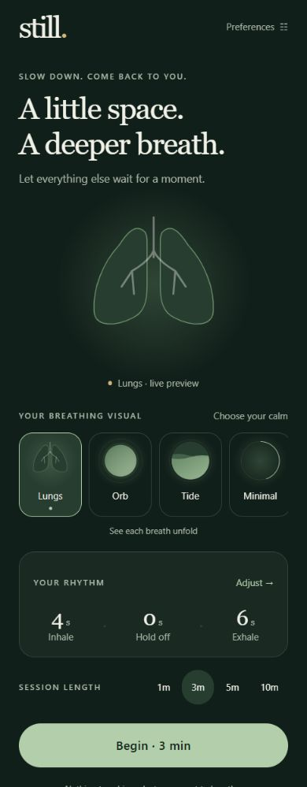
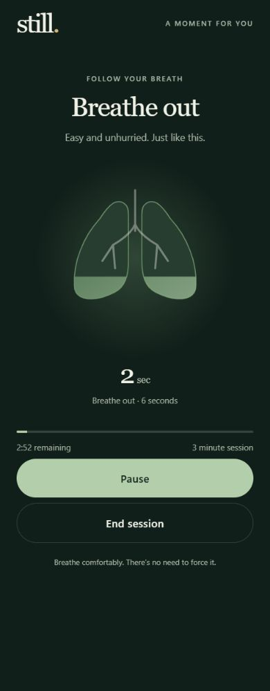
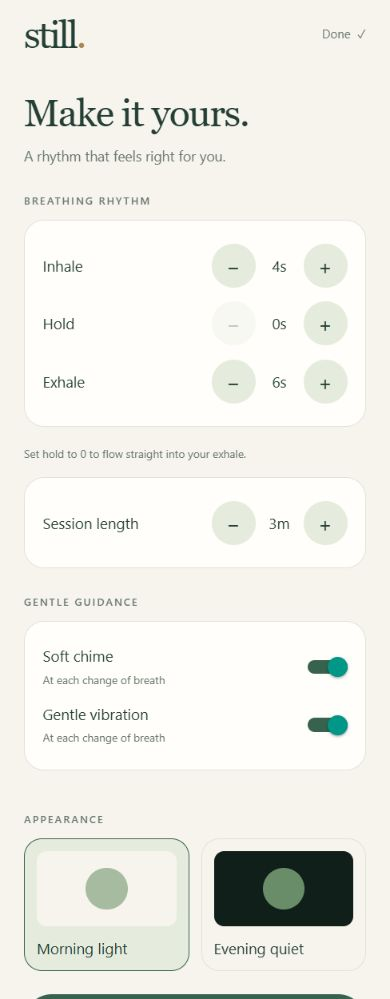

# Still

A free breathing companion for iOS and Android, built with React Native, Expo SDK 57, and TypeScript. A web preview uses the same app code.

**Live app:** [still-4tb.pages.dev](https://still-4tb.pages.dev/)

## Screenshots

Mobile-sized captures of the running web preview. Native iOS and Android appearance may differ slightly.

| Home · dark | Lungs breathing session | Preferences · light |
| :---: | :---: | :---: |
|  |  |  |

## Tech stack

| Technology | Role |
| --- | --- |
| TypeScript | Typed app logic, settings validation, and breathing calculations |
| React 19 | Components, state, and screen composition |
| React Native 0.86 | Shared mobile interface for iOS and Android |
| Expo SDK 57 | Mobile development tooling and native modules |
| React Native SVG | Lungs, Orb, Tide, Minimal Timer, and Path visuals |
| Expo Audio | Locally bundled, synthesized chime at phase changes |
| Expo Haptics | Optional vibration cues |
| Expo Keep Awake | Keeps the screen awake during active sessions |
| AsyncStorage | Saves preferences on the device |
| React Native Safe Area Context | Layout around device safe areas |
| Expo Status Bar | Status-bar appearance for light and dark themes |
| React Native Web + React DOM | Browser preview from the same app code |
| Node.js + npm | Local development runtime and dependency management |
| Node.js test runner | Breathing logic and settings-validation tests |
| Expo EAS | Prepared cloud build and store-submission profiles |

The session clock uses elapsed time with `requestAnimationFrame` to update the guide. No backend, cloud database, account system, or health integration is used in V1. Exact package versions are recorded in `package.json` and `package-lock.json`.

## Included in this first version

- Lungs (default), Orb, Tide, Minimal Timer, and Path, with live previews.
- Path uses three triangle sides when holding is enabled, or two circular arcs when hold is zero.
- Default rhythm: inhale 4 seconds, hold 0, exhale 6. Adjustable inhale/exhale from 1–20 seconds, hold from 0–20 seconds.
- Lungs fill during inhale, stay full during hold, and empty during exhale.
- Sessions from 1–30 minutes, pause/resume, early ending, and a completion screen.
- Dark theme by default, an optional light theme, and independently switchable chime and haptics.
- Preferences saved locally; no accounts, ads, analytics, server, or health permissions.
- Screen-reader phase announcements and a minimal timer when the device requests reduced motion.
- Screen stays awake during an active session. Leaving the foreground pauses the session; returning requires an explicit resume.

## Run

Use Node.js 22.13+ or 24 LTS, with npm.

```sh
npm install
npm start
```

Open the QR code in a compatible Expo Go client on an iPhone or Android phone connected to the same network. The installed SDK must match the Expo Go client. This is a development preview, not an App Store / Play Store installation.

On this computer dependencies are already installed. If npm is unavailable in the terminal, run:

```sh
node node_modules/expo/bin/cli start --lan
```

For a browser development preview:

```sh
npm run web
```

For the built local preview:

```sh
node node_modules/expo/bin/cli export --platform web
node scripts/preview.cjs
```

Open http://localhost:8081. The preview server binds only to this computer.

## Verification

```sh
npm run typecheck
npm test
node node_modules/expo/bin/cli export --platform ios --platform android --output-dir work/native-export
```

Tests cover phase boundaries, zero hold, fill levels, skipped frames, saved-setting validation, and countdown formatting. Native exports verify bundling, not execution on a physical phone.

## Before release

Test on real iOS and Android devices: phase timing, audio/silent mode, vibration support, interruptions, backgrounding, screen readers, large text, small screens, and battery use. Build signed native binaries using the eventual owner’s bundle identifiers and developer accounts. Store submission, name availability, and production signing are not configured yet. iOS local native builds require macOS/Xcode; cloud builds can be used from Windows.

Health integration is explicitly deferred to V2. No session history is stored yet. The session ends at its selected duration even if that falls partway through a breath cycle. Preferences auto-save as they change. The original synthesized chime can be regenerated with `node scripts/generate-chime.cjs`.

## Source

- `App.tsx`: screens, session clock, cues, and saved preferences.
- `src/breathing.ts`: deterministic timing and settings validation.
- `src/BreathVisual.tsx`: SVG breathing visuals.
- `src/theme.ts`: colors.
- `tests/breathing.test.ts`: timing tests.

Official references: [Expo SDK](https://docs.expo.dev/versions/latest/), [audio](https://docs.expo.dev/versions/latest/sdk/audio/), [haptics](https://docs.expo.dev/versions/latest/sdk/haptics/).

## V2 roadmap

- Make Still available from desktop browsers.
- Make Still available from mobile browsers.
- Add Progressive Web App (PWA) support so users can add Still to their device home screen and use it without installing from Google Play or the Apple App Store.
- Support offline use where the browser and device allow it.
- Add health-app integration for supported platforms.

Browser support for vibration, audio behavior, offline use, and screen wake may vary by device and browser.


